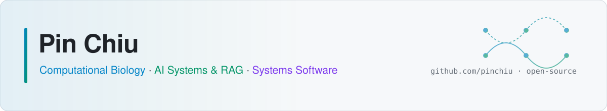

<!-- This file is auto-generated from README.template.md by scripts/build_readme.py. Edit README.template.md directly, do not edit README.md. -->

<picture>
  <source media="(prefers-color-scheme: dark)" srcset="./assets/banner-dark.svg">
  
</picture>

  

  
  
  
  
  
  
  
  
  
  

## 👋 About

I'm Scott, a bioinformatics and engineering student. I build small, complete systems and ship them in the open — mostly tools that stay fast, private, and easy to reason about.

## 🚀 Selected Work

| Project | Stack | Status | Scale | What it is |
|---|---|:---:|---|---|
| **Wake-on-LAN for Android**   [repo](https://github.com/pinchiu/wake-on-lan-for-android) |     |  | **113 commits**   2 Android apps   3 desktop OSes | Remote power control from Android over LAN, Tailscale, or MQTT, backed by a zero-dependency Rust daemon. |
| **Antigravity Updater**   [repo](https://github.com/pinchiu/antigravity-updater-for-ubuntu) |   |  | **10 commits**   Automated CLI | Dedicated updater and maintenance utility for developer workstations running Ubuntu, ensuring reproducible toolchain environments. |
| **USB Sound Connect**   [repo](https://github.com/pinchiu/usb-sound-connect) |   |  | **10 commits**   Low-level C++ | Lightweight native audio hardware connector and device switcher for Linux audio subsystems. |

Metrics re-indexed from repositories. Last updated 2026-11-17.

## 📦 Open Source Repositories

| Repository | Focus &amp; Capability |
|---|---|
| [pinchiu/wake-on-lan-for-android](https://github.com/pinchiu/wake-on-lan-for-android) | Native Android remote + home gateway, plus a cross-platform Rust power daemon |
| [pinchiu/antigravity-updater-for-ubuntu](https://github.com/pinchiu/antigravity-updater-for-ubuntu) | Automated developer workstation update script for Ubuntu |
| [pinchiu/usb-sound-connect](https://github.com/pinchiu/usb-sound-connect) | Native C++ sound device management utility |
| [pinchiu/pdf-bookshelf-extension](https://github.com/pinchiu/pdf-bookshelf-extension) | Browser extension for organized document shelving and reader workflows |

## 🛠 Skills & Engineering Capabilities

- **Systems & Networking** — Rust daemons, signed UDP/TCP command protocols, MQTT, Kotlin/Android, and C++ device integration.
- **AI & Local-First Tooling** — RAG pipelines, local LLM serving, vector search, and AST / LaTeX parsing.
- **Computational Biology & Data Science** — Genomics data analysis, statistical modeling, and scientific Python (Pandas / NumPy / Seaborn).
- **Tooling & Infrastructure** — Docker &amp; Compose, Pixi environments, Linux services and autostart, and GitHub Actions CI/CD.

## 📈 Languages & Code Distribution

Code volume breakdown across repositories, compiled from codebase analysis:

<picture>
  <source media="(prefers-color-scheme: dark)" srcset="./assets/languages-dark.svg">
  
</picture>
