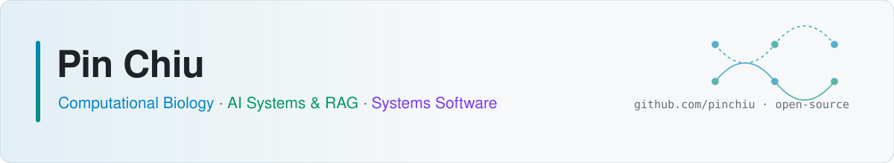
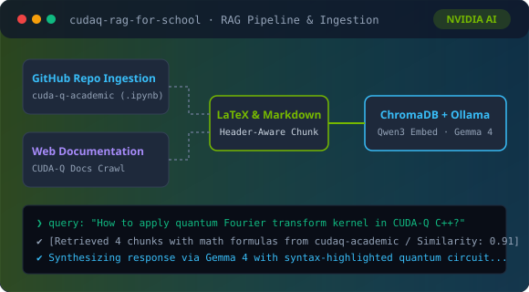
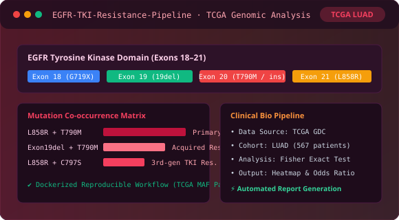
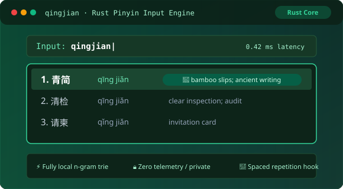
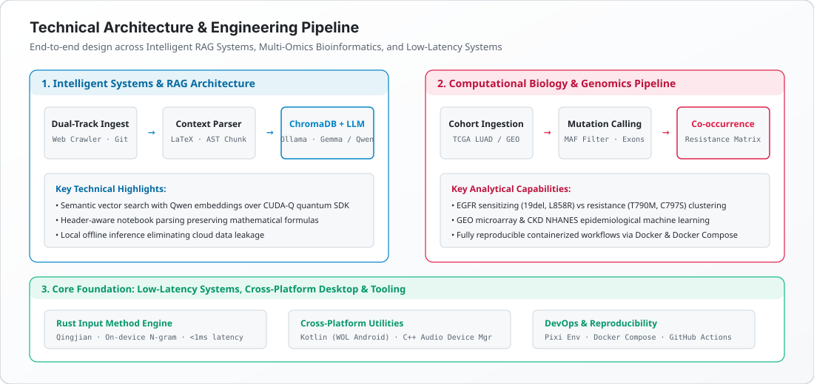
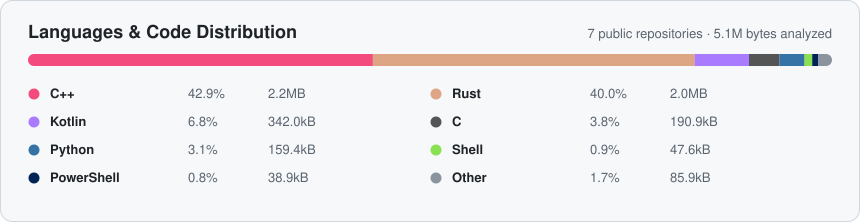

<!-- This file is auto-generated from README.template.md by scripts/build_readme.py. Edit README.template.md directly, do not edit README.md. -->

<picture>
  <source media="(prefers-color-scheme: dark)" srcset="./assets/banner-dark.svg">
  
</picture>

  
  
  
  

  
  
  
  
  
  
  
  
  
  

## 👋 About

I engineer systems at the convergence of **Intelligent AI Applications**, **Computational Biology & Healthcare Analytics**, and **Low-Latency Systems Tooling**. My work ranges from building end-to-end RAG knowledge engines with vector indexing and local LLMs to containerized cancer genomics pipelines mining high-throughput TCGA datasets. 

On the open-source side, I actively develop and maintain solutions including **[CUDA-Q RAG](https://github.com/pinchiu/cudaq-rag-for-school)** for quantum computing knowledge retrieval, the **[EGFR-TKI Resistance Pipeline](https://github.com/pinchiu/EGFR-TKI-Resistance-Pipeline)** for lung adenocarcinoma mutation analysis, and contribute to **[Qingjian 青简](https://github.com/pinchiu/qingjian)**, a high-performance Rust input method engine designed to teach contextual language vocabulary with sub-millisecond keystroke latency.

The repository statistics, commit metrics, and language distribution card below are automatically recompiled and refreshed weekly via GitHub Actions.

## 🖥 Showcase

<table>
  <tr>
    <td width="50%" align="center">
       
      <b>CUDA-Q RAG Assistant</b> · Dual-track ingestion, LaTeX formula parsing &amp; ChromaDB vector store
    </td>
    <td width="50%" align="center">
       
      <b>EGFR-TKI Resistance Pipeline</b> · TCGA lung adenocarcinoma mutation co-occurrence matrix
    </td>
  </tr>
  <tr>
    <td colspan="2" align="center">
       
      <b>Qingjian 青简</b> · High-performance Rust pinyin IME with contextual translation per keystroke
    </td>
  </tr>
</table>

## 🏗 Engineering Architecture

Multi-tier workflow illustrating how unstructured documents, multi-omics clinical cohorts, and local systems integrate seamlessly.

<picture>
  <source media="(prefers-color-scheme: dark)" srcset="./assets/architecture-dark.svg">
  
</picture>

## 🚀 Selected Work

| Project | Stack | Status | Scale | What it is |
|---|---|:---:|---|---|
| **CUDA-Q RAG Assistant**   [repo](https://github.com/pinchiu/cudaq-rag-for-school) |     |  | **22 commits**   Dual-track Ingestion   Local LLM Serving | Intelligent QA assistant for the NVIDIA CUDA-Q framework. Crawls documentation and clones academic GitHub repos, parses AST/LaTeX formulas, and indexes embeddings into ChromaDB for high-precision retrieval. |
| **EGFR-TKI Resistance Pipeline**   [repo](https://github.com/pinchiu/EGFR-TKI-Resistance-Pipeline) |     |  | **28 commits**   TCGA LUAD Cohort   Dockerized Workflow | Cancer genomics pipeline analyzing Lung Adenocarcinoma (LUAD) data from TCGA. Examines co-occurrence between sensitizing mutations (19del, L858R) and resistance mutations (T790M, C797S) with automated visualization. |
| **Qingjian 青简**   [repo](https://github.com/pinchiu/qingjian) |   |  | **70 commits**   On-device N-gram   &lt;1ms Latency | Cross-platform pinyin input method that displays vocabulary translations next to candidates in the language you are learning. Zero-telemetry, fully local dictionary and adaptive learning engine. |
| **Wisdom-Weasel**   [repo](https://github.com/pinchiu/Wisdom-Weasel) |   |  | **11 commits**   IME Extension | LLM-powered context enhancement for Rime (小狼豪) input method, delivering intelligent Chinese text completion and sentence generation. |
| **Antigravity Updater**   [repo](https://github.com/pinchiu/antigravity-updater-for-ubuntu) |   |  | **10 commits**   Automated CLI | Dedicated updater and maintenance utility for developer workstations running Ubuntu, ensuring reproducible toolchain environments. |
| **Wake-on-LAN for Android**   [repo](https://github.com/pinchiu/wake-on-lan-for-android) |   |  | **63 commits**   Native Android | Clean and efficient network utility to wake desktop rigs and servers over local area networks with broadcast magic packets. |
| **USB Sound Connect**   [repo](https://github.com/pinchiu/usb-sound-connect) |   |  | **10 commits**   Low-level C++ | Lightweight native audio hardware connector and device switcher for Linux audio subsystems. |

Metrics re-indexed from repositories. Last updated 2026-11-01.

## 📦 Open Source Repositories

| Repository | Focus &amp; Capability |
|---|---|
| [pinchiu/cudaq-rag-for-school](https://github.com/pinchiu/cudaq-rag-for-school) | Dual-track RAG QA engine for NVIDIA CUDA-Q with LaTeX parsing and ChromaDB |
| [pinchiu/EGFR-TKI-Resistance-Pipeline](https://github.com/pinchiu/EGFR-TKI-Resistance-Pipeline) | Cancer genomics mutation analysis pipeline for TCGA LUAD data |
| [pinchiu/qingjian](https://github.com/pinchiu/qingjian) | High-performance Rust pinyin IME with contextual translation per keystroke |
| [pinchiu/Wisdom-Weasel](https://github.com/pinchiu/Wisdom-Weasel) | LLM-powered completion and text expansion plugin for Rime Weasel |
| [pinchiu/wake-on-lan-for-android](https://github.com/pinchiu/wake-on-lan-for-android) | Native Kotlin Wake-on-LAN client with zero background bloat |
| [pinchiu/antigravity-updater-for-ubuntu](https://github.com/pinchiu/antigravity-updater-for-ubuntu) | Automated developer workstation update script for Ubuntu |
| [pinchiu/usb-sound-connect](https://github.com/pinchiu/usb-sound-connect) | Native C++ sound device management utility |
| [pinchiu/pdf-bookshelf-extension](https://github.com/pinchiu/pdf-bookshelf-extension) | Browser extension for organized document shelving and reader workflows |

## 🛠 Skills & Engineering Capabilities

- **AI & Intelligent Systems** — RAG (Retrieval-Augmented Generation), local LLM orchestration (Ollama, Gemma, Qwen), vector search (ChromaDB), AST parsing, and LaTeX mathematical formula extraction.
- **Computational Biology & Data Science** — High-throughput genomics pipelines, TCGA LUAD cohort mining, GEO microarray analysis, epidemiological ML models (CKD NHANES), variant co-occurrence analysis, and Pandas / NumPy / Seaborn scientific computing.
- **Systems & Core Languages** — **Python** (primary data science and AI language), **Rust** (memory-safe systems and fast input engines), **C++** (low-level device integration), **Kotlin** (native Android), and **C# / .NET** (desktop applications).
- **Tooling & Infrastructure** — Docker & Docker Compose containerization, Pixi reproducible environments, Linux system administration, and GitHub Actions CI/CD automation.

## 🧭 Now

- Advancing **CUDA-Q RAG** with dynamic reranking models and expanded quantum algorithm benchmarks.
- Expanding **EGFR-TKI Resistance Pipeline** to integrate multi-cohort validation and Kaplan-Meier survival curves.
- Optimizing **Qingjian** core Trie dictionary structures for ultra-low latency on macOS and Linux.

## 📈 Languages & Code Distribution

Code volume breakdown across repositories, compiled from codebase analysis:

<picture>
  <source media="(prefers-color-scheme: dark)" srcset="./assets/languages-dark.svg">
  
</picture>
