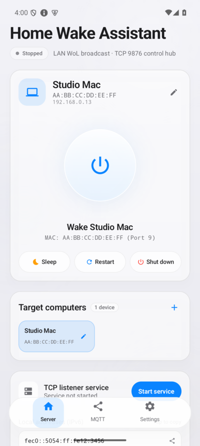
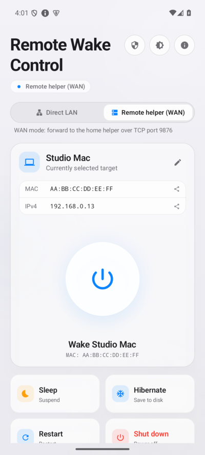
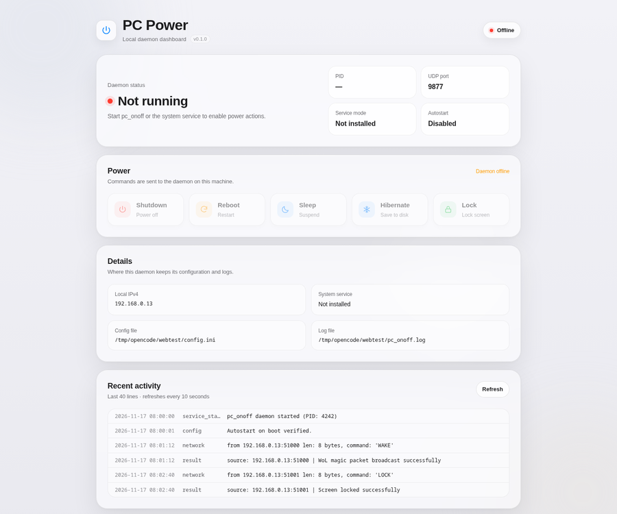
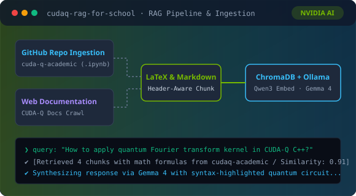
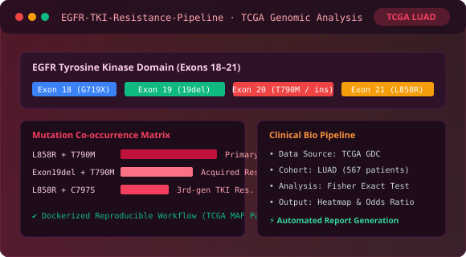
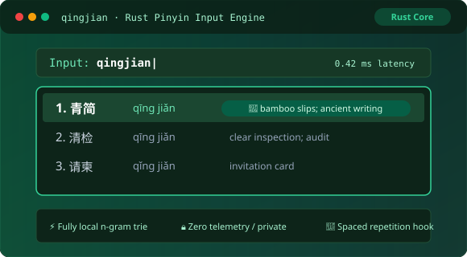
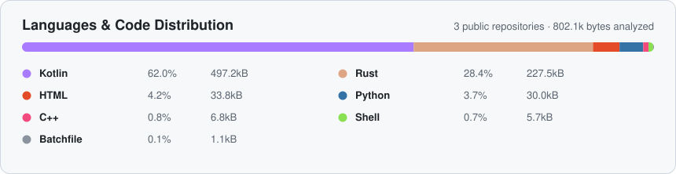

<!-- This file is auto-generated from README.template.md by scripts/build_readme.py. Edit README.template.md directly, do not edit README.md. -->

<picture>
  <source media="(prefers-color-scheme: dark)" srcset="./assets/banner-dark.svg">
  
</picture>

  
  
  
  

  
  
  
  
  
  
  
  
  
  

## 👋 About

I'm Scott, a bioinformatics and engineering student who builds small, complete systems and ships them in the open. Most of my time right now goes into **[Wake-on-LAN for Android](https://github.com/pinchiu/wake-on-lan-for-android)**: two Kotlin apps and a zero-dependency Rust daemon that let me wake, shut down, reboot, sleep, hibernate, or lock my computers from anywhere.

The rest of my work follows the same pattern — local-first RAG for NVIDIA CUDA-Q, a TCGA lung-cancer mutation pipeline, and Qingjian, a Rust pinyin IME that shows translations beside its candidates. Different domains, same goal: software that stays fast, private, and easy to reason about.

## 🔌 Featured Project — Wake-on-LAN for Android

**A phone in your pocket, a spare phone at home, and full control of the PC.**

Wake-on-LAN for Android is a complete remote power system. The **Remote Phone** app sends commands from anywhere; the **Home Phone** app turns a spare Android device into a LAN gateway; and the **`pc_onoff`** daemon executes them on Windows, Linux, or macOS. Power-on uses a standard magic packet. Everything else — shutdown, reboot, sleep, hibernate, screen lock — goes through the daemon's UDP protocol, signed whenever the path leaves a private network.

| Capability | What it does |
|---|---|
| **Power, not just wake** | Magic packet for power-on, plus shutdown, reboot, sleep, hibernate, and screen lock. |
| **Reachable from anywhere** | Home Wi-Fi, TCP over IPv6/IPv4 through a spare phone, MQTT over TLS, or a direct UDP path on the same network. |
| **Signed on public paths** | HMAC-SHA256 envelopes with timestamp and nonce replay protection. LAN and Tailscale traffic is trusted without a secret. |
| **One daemon, three OSes** | `pc_onoff` is a zero-dependency Rust binary for Windows, Linux, and macOS, with autostart, an optional boot-time Linux service, 5 MB log rotation, and a loopback dashboard. |
| **Native Android** | Two Kotlin apps, multi-PC profiles, home-screen widgets, a voice-assistant shortcut, and an English / 繁體中文 interface. |

<table>
  <tr>
    <td width="50%" align="center"></td>
    <td width="50%" align="center"></td>
  </tr>
  <tr>
    <td align="center"><b>Home Phone</b> · LAN gateway</td>
    <td align="center"><b>Remote Phone</b> · control from anywhere</td>
  </tr>
</table>

  
   
  <b>pc_onoff dashboard</b> · local status, logs, and power actions on 127.0.0.1:9878

  <b><a href="https://github.com/pinchiu/wake-on-lan-for-android">Repository</a></b> ·
  <b><a href="https://github.com/pinchiu/wake-on-lan-for-android/releases">Releases</a></b> ·
  <b><a href="https://pinchiu.github.io/wake-on-lan-for-android/architecture.html">Interactive architecture</a></b> ·
  MIT

### How it moves

| Hop | Transport |
|---|---|
| Remote phone → home phone | TCP `9876`, HMAC-signed on public paths |
| Remote phone → PC on the same Wi-Fi | UDP `9877`, signed when needed |
| Home phone → PC | UDP `9877`, plus a UDP `9` magic packet for wake |
| No port-forward | MQTT over TLS |

Tailscale is the recommended way in. Port-forwarding UDP `9877` or TCP `9876` without a secret is not.

## 🏗 System Architecture

The main control path and the wake-only bypass. The home phone is optional when you are on the same network or using Tailscale.

<picture>
  <source media="(prefers-color-scheme: dark)" srcset="./assets/wol-architecture-dark.svg">
  
</picture>

More detail, including the MQTT and direct-LAN paths: **[interactive architecture diagram](https://pinchiu.github.io/wake-on-lan-for-android/architecture.html)**.

## 🖥 More Projects

<table>
  <tr>
    <td width="50%" align="center">
       
      <b>CUDA-Q RAG Assistant</b> · Dual-track ingestion, LaTeX formula parsing &amp; ChromaDB vector store
    </td>
    <td width="50%" align="center">
       
      <b>EGFR-TKI Resistance Pipeline</b> · TCGA lung adenocarcinoma mutation co-occurrence matrix
    </td>
  </tr>
  <tr>
    <td colspan="2" align="center">
       
      <b>Qingjian 青简</b> · High-performance Rust pinyin IME with contextual translation per keystroke
    </td>
  </tr>
</table>

## 🚀 Selected Work

| Project | Stack | Status | Scale | What it is |
|---|---|:---:|---|---|
| **Wake-on-LAN for Android**   [repo](https://github.com/pinchiu/wake-on-lan-for-android) |     |  | **70 commits**   2 Android apps   3 desktop OSes | Remote power control for Windows, Linux, and macOS. Two Kotlin apps (remote controller and home gateway) talk to a zero-dependency Rust daemon over LAN, Tailscale, or MQTT, with HMAC-signed commands on public paths. |
| **CUDA-Q RAG Assistant**   [repo](https://github.com/pinchiu/cudaq-rag-for-school) |     |  | **22 commits**   Dual-track Ingestion   Local LLM Serving | Intelligent QA assistant for the NVIDIA CUDA-Q framework. Crawls documentation and clones academic GitHub repos, parses AST/LaTeX formulas, and indexes embeddings into ChromaDB for high-precision retrieval. |
| **EGFR-TKI Resistance Pipeline**   [repo](https://github.com/pinchiu/EGFR-TKI-Resistance-Pipeline) |     |  | **28 commits**   TCGA LUAD Cohort   Dockerized Workflow | Cancer genomics pipeline analyzing Lung Adenocarcinoma (LUAD) data from TCGA. Examines co-occurrence between sensitizing mutations (19del, L858R) and resistance mutations (T790M, C797S) with automated visualization. |
| **Qingjian 青简**   [repo](https://github.com/pinchiu/qingjian) |   |  | **70 commits**   On-device N-gram   &lt;1ms Latency | Cross-platform pinyin input method that displays vocabulary translations next to candidates in the language you are learning. Zero-telemetry, fully local dictionary and adaptive learning engine. |
| **Wisdom-Weasel**   [repo](https://github.com/pinchiu/Wisdom-Weasel) |   |  | **11 commits**   IME Extension | LLM-powered context enhancement for Rime (小狼豪) input method, delivering intelligent Chinese text completion and sentence generation. |
| **Antigravity Updater**   [repo](https://github.com/pinchiu/antigravity-updater-for-ubuntu) |   |  | **10 commits**   Automated CLI | Dedicated updater and maintenance utility for developer workstations running Ubuntu, ensuring reproducible toolchain environments. |
| **USB Sound Connect**   [repo](https://github.com/pinchiu/usb-sound-connect) |   |  | **10 commits**   Low-level C++ | Lightweight native audio hardware connector and device switcher for Linux audio subsystems. |

Metrics re-indexed from repositories. Last updated 2026-11-15.

## 📦 Open Source Repositories

| Repository | Focus &amp; Capability |
|---|---|
| [pinchiu/wake-on-lan-for-android](https://github.com/pinchiu/wake-on-lan-for-android) | Native Android remote + home gateway, plus a cross-platform Rust power daemon |
| [pinchiu/cudaq-rag-for-school](https://github.com/pinchiu/cudaq-rag-for-school) | Dual-track RAG QA engine for NVIDIA CUDA-Q with LaTeX parsing and ChromaDB |
| [pinchiu/EGFR-TKI-Resistance-Pipeline](https://github.com/pinchiu/EGFR-TKI-Resistance-Pipeline) | Cancer genomics mutation analysis pipeline for TCGA LUAD data |
| [pinchiu/qingjian](https://github.com/pinchiu/qingjian) | High-performance Rust pinyin IME with contextual translation per keystroke |
| [pinchiu/Wisdom-Weasel](https://github.com/pinchiu/Wisdom-Weasel) | LLM-powered completion and text expansion plugin for Rime Weasel |
| [pinchiu/antigravity-updater-for-ubuntu](https://github.com/pinchiu/antigravity-updater-for-ubuntu) | Automated developer workstation update script for Ubuntu |
| [pinchiu/usb-sound-connect](https://github.com/pinchiu/usb-sound-connect) | Native C++ sound device management utility |
| [pinchiu/pdf-bookshelf-extension](https://github.com/pinchiu/pdf-bookshelf-extension) | Browser extension for organized document shelving and reader workflows |

## 🛠 Skills & Engineering Capabilities

- **Systems & Networking** — Rust daemons, Wake-on-LAN, signed UDP/TCP command protocols, MQTT, Kotlin/Android, and C++ device integration.
- **AI & Local-First Tooling** — RAG pipelines, local LLM serving (Ollama, Gemma, Qwen), ChromaDB vector search, AST and LaTeX parsing.
- **Computational Biology & Data Science** — TCGA LUAD and GEO pipelines, EGFR variant co-occurrence, NHANES epidemiological ML, and Pandas / NumPy / Seaborn.
- **Tooling & Infrastructure** — Docker &amp; Compose, Pixi environments, Linux services and autostart, and GitHub Actions CI/CD.

## 🧭 Now

- **Wake-on-LAN for Android** — tightening the Frost UI, LAN/Tailscale trust, and the cross-platform `pc_onoff` daemon.
- **CUDA-Q RAG** — dynamic reranking and expanded quantum algorithm benchmarks.
- **Qingjian** — Trie dictionary optimizations for lower latency on macOS and Linux.

## 📈 Languages & Code Distribution

Code volume breakdown across repositories, compiled from codebase analysis:

<picture>
  <source media="(prefers-color-scheme: dark)" srcset="./assets/languages-dark.svg">
  
</picture>
